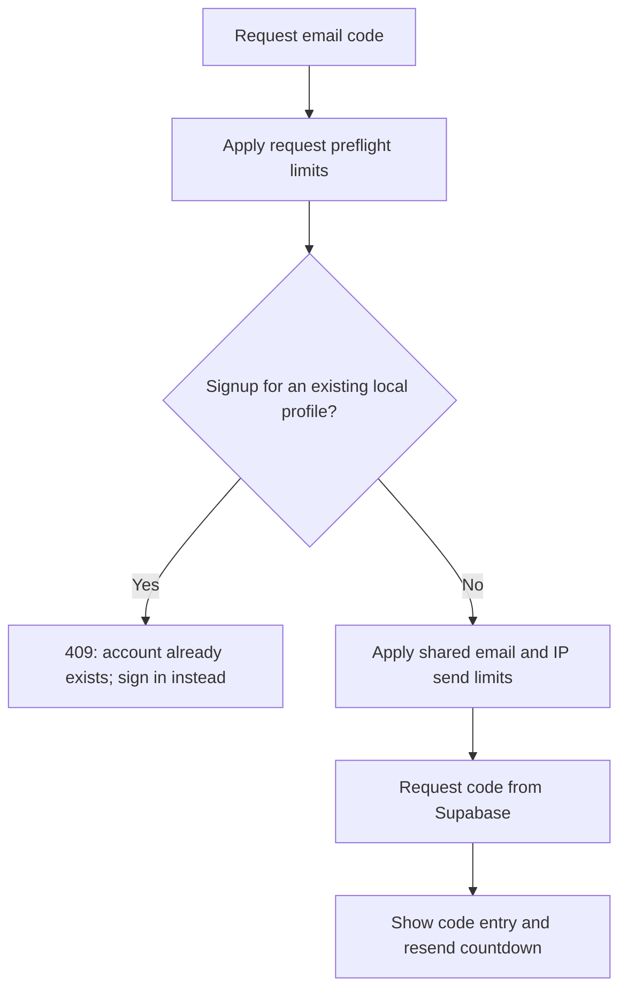

# Signup behavior and authentication rate limits

Updated October 19, 2026. This explains the fixes made after browser testing.

## What was happening

Supabase's OTP `create_user=true` option means "create a user if necessary."
It does not mean "send only if the account is new." An existing account can
receive a sign-in code through that endpoint. Udhaar must enforce its own
signup-form behavior. See [passwordless authentication](https://supabase.com/docs/guides/auth/auth-email-passwordless).

Previously, every protected Udhaar request called Supabase's `/user` endpoint.
Our server-side requests share the backend's outbound address, so ordinary use
could consume the provider's authentication limits. The application also allowed
five send attempts per minute for one email, despite Supabase's normal 60-second
interval between code requests for the same user.

## New signup and sign-in behavior

The backend normalizes the email before checking `users`. Existing Udhaar profiles,
including legacy local profiles, cannot request another signup email. A rejected
duplicate signup does not contact Supabase or consume the email-send cooldown;
the user can switch to sign-in. The UI always provides that switch.

Signup can still complete for an identity that exists only in Supabase but has
not successfully created a local Udhaar profile, such as an interrupted signup.
This implementation does not require an administrative Supabase API key to list
all provider users. Local application profiles define registered Udhaar accounts.
Returning an explicit "already exists" error discloses that an email is registered;
this matches the requested signup UX.

## Three independent limit layers

### Udhaar's backend

| Operation | Limit | Scope |
|---|---|---|
| Request/preflight check | 10 attempts in 60 seconds | Per IP and per email |
| Actual code-send attempt | 1 attempt in 60 seconds | Per normalized email, shared by signup/sign-in/resend |
| Actual code-send attempt | 5 attempts in 60 seconds | Per IP across email addresses |
| Code verification | 10 attempts in 60 seconds | Per IP and per email |

These are sliding-window limits, protected by a process lock. The response is
HTTP 429 with the actual remaining local wait in `Retry-After`. Send attempts
count even if the upstream email request fails, preventing retry storms.

Counters are bounded in memory and reset when the application process restarts.
They are not shared across workers/servers. Distributed production limits still
need a shared store and correct proxy/client-IP handling.

### Supabase

Supabase independently limits same-user email sends, project email volume,
authentication requests by IP, verification, and token refresh. Check your actual
values in **Authentication > Rate Limits**. Its published same-user OTP cooldown
is normally 60 seconds. Shared backend IPs can aggregate multiple people's
requests; forwarding client IPs has separate requirements and is not enabled here.
See [Supabase rate-limit documentation](https://supabase.com/docs/guides/auth/rate-limits).

Provider HTTP 429 responses remain 429. If Supabase supplies a valid numeric
`Retry-After`, the application preserves it; it no longer claims every provider
limit will reset after exactly 60 seconds. A project/hourly limit may last longer
than the UI's fallback cooldown. Repeated retries do not reset the provider bucket.

### Email sender

Resend or another SMTP sender has its own account sending limits and daily/monthly
quotas. Passing Udhaar and Supabase checks does not override the sender's limits.
Check the sender dashboard's usage, delivery failures, and suppression information.
The app uses Supabase SMTP delivery; Resend's HTTP API request limit is not the
same thing as our browser-request or email-send limits.

## Reducing avoidable authentication requests

The auth-config response now reports whether any auth cookies are present.
A fresh signed-out page goes directly to the form, without unnecessary `/me`
and `/refresh` failures. No cookie values are returned in that config response.

Normal protected requests verify the JWT locally with cached public JWKS keys.
Validation checks the signature, issuer, audience, expiry, issued-at, subject UUID,
authenticated role, and non-anonymous account status. ES256/RS256 are supported;
the configured project advertises ES256. There is no unsigned-token or HS256 fallback.
Key sets are cached for ten minutes; the app never obtains a private signing key.
See [Supabase JWT verification](https://supabase.com/docs/guides/auth/jwts).

Code verification and refresh still validate provider user information over HTTPS.
JWT verification removes the routine per-record `/user` call while retaining
signature/expiry validation. Provider-side account changes are therefore observed
at revalidation/refresh rather than guaranteed on every request; an issued token
may remain usable until expiry.

## Browser behavior

- Send/resend controls show a countdown for the entered email.
- Switching between signup/sign-in/change-email views retains the in-page cooldown.
- A 429 updates the timer using `Retry-After` when available.
- Verification also shows a wait countdown after a rate-limit response.
- A shared submitting flag blocks simultaneous requests from double-clicks/Enter.
- Timers only update controls; they never automatically request another email.
- Reloading the page clears UI-only timing state, but the backend still enforces
  the remaining cooldown and stops another upstream email request.

## Regression checks

Tests cover duplicate signup without sending an email, subsequent sign-in,
case/whitespace normalization, cooldown across browsers/forms, accurate retry
intervals, IP limits, provider retry headers, and repeated application requests
without extra Supabase calls. Signed test JWTs exercise wrong issuer/audience,
expired tokens, future times, invalid UUIDs/roles, anonymous identities, and forged
signatures. Provider calls are simulated; no test sends real email.

For manual retesting: sign out, try signup for an existing Udhaar account, and
expect the instruction to sign in with no new message in Resend. Switch to sign-in,
request one code, then verify an immediate resend is blocked with a countdown.
If a previous Supabase project limit is already exhausted, it must still refill;
rebuilding Udhaar cannot clear that external limit.
