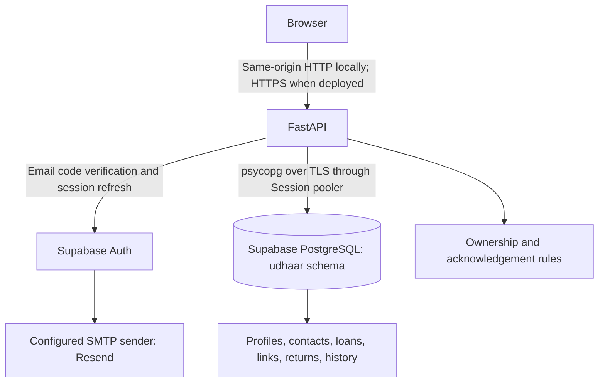

# Supabase PostgreSQL: setup, migrations, and deployment

Updated October 19, 2026. Udhaar now supports hosted Supabase PostgreSQL through
the existing SQLAlchemy/psycopg backend. Authentication and loan permissions keep
their existing flows. Supabase's Data API, Storage, and Realtime are not required.

## Two environments

| Environment | Application address | Application database | Schema |
|---|---|---|---|
| Local development | `http://localhost:8000` | Docker PostgreSQL | `public` |
| Hosted database staging | `http://127.0.0.1:8001` | Supabase PostgreSQL | `udhaar` |

The second application still runs on your computer. Its database runs on
Supabase. This step does not publish the application to the internet.

Use a private browser window for staging, or use the different hostnames above:
browser cookies are shared across ports on the same hostname. Both environments
currently use the existing Supabase Auth project. Separate production Auth and
database credentials should be configured before a public release.



Cloud staging starts with fresh application data. Existing local profiles and
loans remain in Docker; they were not automatically uploaded. Signing in to
staging creates a separate application profile linked to the same Supabase Auth
identity. Loans and links created in one environment belong to that environment.

## Connection credentials

In Supabase, select **Connect > Session pooler** and copy its PostgreSQL URI.
The shared session pooler uses port `5432` and an account such as
`postgres.PROJECT_REF`. Copy its actual host; do not guess the region or pooler
index. See [Supabase connection guidance](https://supabase.com/docs/guides/database/connecting-to-postgres).

Save the complete URI locally as `SUPABASE_DATABASE_URL` in `.env`. Replace the
password placeholder with the project's **database password**, without brackets,
and URL-encode special characters in the password. Keep `sslmode=require` in
the query string. The app accepts `postgresql://` and normalizes it to the
installed `postgresql+psycopg://` driver.

The database password is separate from your dashboard password, local Docker
`POSTGRES_PASSWORD`, and API keys. If forgotten, reset it under **Database >
Settings**. [Password reset instructions](https://supabase.com/docs/guides/troubleshooting/how-do-i-reset-my-supabase-database-password-oTs5sB)

| Variable | Meaning |
|---|---|
| `SUPABASE_DATABASE_URL` | Secret hosted database connection, used by the hosted Compose stack |
| `SUPABASE_URL` | Supabase Auth project URL |
| `SUPABASE_PUBLISHABLE_KEY` | Key for Auth API calls; cannot replace the database password |
| `SUPABASE_APP_PORT` | Staging app port, default `8001` |
| `UDHAAR_HOSTED_COOKIE_SECURE` | `false` for local HTTP testing; `true` behind HTTPS |

`.env` and backups are excluded from Git and Docker build context. No database
credential belongs in frontend JavaScript. The hosted Compose file passes the
URI to the backend as `UDHAAR_DATABASE_URL`, with
`UDHAAR_DATABASE_SCHEMA=udhaar` and `UDHAAR_ENV=staging`.

## Migrations and startup

The application no longer changes tables when imported or started. Alembic
migrations run as an explicit release step. The web process checks the recorded
revision and required tables at startup, and refuses to start if migrations are
missing. A health check alone is not a substitute for that startup check.

```mermaid
flowchart LR
    Config[Read database settings] --> Lock[Acquire per-schema migration lock]
    Lock --> Schema[Create dedicated schema if missing]
    Schema --> Initial[0001: create nine application tables]
    Initial --> Security[0002: restrict database access]
    Security --> Version[Record Alembic revision]
    Version --> Check[App verifies revision and tables]
    Check --> Serve[Serve requests]
```



The migration lock is transaction-scoped. Concurrent release commands targeting
the same schema wait rather than creating the same objects simultaneously.
Historical table definitions are frozen in the revision file rather than imported
from today's ORM models. Future revisions should use the configured schema and
be reviewed and tested in both local and hosted environments.

Available commands, inside the configured backend environment:

```powershell
python -m backend.migrate current
python -m backend.migrate upgrade
python -m backend.migrate check
```

`current` reads the revision. `upgrade` applies pending revisions. `check` verifies
the revision, required tables, columns, indexes, and constraints against the
application metadata. None of these commands copies user data between databases.
The security revision intentionally refuses an automatic downgrade that would
remove its restrictions.

For an existing database created by the earlier app, first make a backup, then:

```powershell
python -m backend.migrate baseline
python -m backend.migrate upgrade
```

`baseline` checks all nine original tables against the frozen initial definition
before stamping the initial revision. It refuses partial or mismatched schemas.
It does not drop tables, recreate accounts, or rewrite loans. The existing local
Postgres database was backed up under ignored `backups/`, baselined, upgraded,
and checked during implementation.

## Start or inspect hosted staging

```powershell
docker compose -f compose.supabase.yaml up --build -d --wait app
docker compose -f compose.supabase.yaml ps
docker compose -f compose.supabase.yaml exec -T app python -m backend.migrate check
```

Open `http://127.0.0.1:8001` in a private window. The one-shot `migrate` service
must complete before the web service starts. A completed migration container is
expected to show as exited successfully.

In the Supabase Table Editor select the **udhaar** schema. Its ten tables are
the nine application tables plus `alembic_version`. The original `login_sessions`
table remains for local-password compatibility and is unused by Supabase Auth.

Read-only SQL examples:

```sql
select version_num from udhaar.alembic_version;
select count(*) from udhaar.users;
select count(*) from udhaar.records;
```

Local development still uses `docker compose up --build -d --wait` and its own
database volume. Stopping either Compose stack does not delete the other stack's
database. Neither command removes the Supabase database.

## Database access boundaries

All ORM queries explicitly target the configured schema; they do not rely on a
pooler's connection search path. The connection pool allows three normal and
two overflow connections per backend process, with bounded connection waits.
Additional workers or instances multiply that maximum.

The hosted migration creates application tables in `udhaar`, enables row level
security, and revokes schema/table access from `PUBLIC`, `anon`, `authenticated`,
and `service_role` where those roles exist. No policy gives those API roles access
to application rows. Supabase-managed `auth`, `storage`, and other schemas are
not migrated. Do not add `udhaar` to the Data API's exposed schemas or grant those
roles access. The unused Data API can additionally be disabled in the dashboard.
[Supabase API security guidance](https://supabase.com/docs/guides/api/securing-your-api)

The current backend connects as the table owner. Owners bypass RLS, so FastAPI
still enforces record ownership and lender/borrower rules. These restrictions
protect against a second browser/Data API access route; they do not replace
backend authorization. Use a separately scoped runtime database role and separate
migration credentials before a hardened public production deployment.

TLS is required for hosted databases. `sslmode=require` encrypts the connection;
certificate verification with the project's CA is a further production setting.
The initial adapter intentionally uses the Session pooler rather than transaction
pooling. Production also requires explicit PostgreSQL configuration, a private
schema, secure cookies, and Supabase authentication; it cannot silently use SQLite.

## Verification

The implementation was tested with:

- 65 automated tests against Docker PostgreSQL, including migrated API fixtures,
  repeatable upgrades, safe baseline adoption, refusal of schema drift, unchanged
  unrelated schemas, and RLS hiding rows from a non-owner database role.
- The SQLite development path: 63 tests passed, with two PostgreSQL-specific
  schema/role checks skipped.
- Three integration scenarios against the actual Supabase database using temporary
  isolated schemas: stable profiles/account isolation, refresh rotation, and
  anonymous handover plus return acknowledgement. Provider authentication is
  simulated; the database connections and writes are real. Temporary schemas are
  removed afterward, leaving the staging application tables empty.
- 16 headless Edge browser checks against the staging app. Session API responses
  are simulated except the anonymous live-server/CSRF check. No test sends email.
- A real hosted connection confirming TLS, ten RLS-enabled tables, no schema usage
  for browser API roles, and a direct Data API request rejected with HTTP 406.

Repeat the local API suite:

```powershell
docker compose --profile test run --build --rm tests
```

Repeat the selected live-database scenarios:

```powershell
docker compose -f compose.supabase.yaml --profile test run --build --rm tests
```

Repeat browser checks after installing `tests/browser` development dependencies:

```powershell
$env:UDHAAR_TEST_BASE_URL = 'http://127.0.0.1:8001'
node tests/browser/sessions.cjs
```

Finally, manually sign in with a real email code, create a staging loan, refresh
the page, and inspect `udhaar.records` in Supabase. Existing local records will
not appear there. Real Auth multi-device revocation and concurrent-tab refresh
still require live-provider testing.

## Before publishing

This completes hosted database staging, not public application hosting. Remaining
work includes an app host/domain with HTTPS, environment separation, restricted
runtime credentials, backups with a restore drill, concurrent-return protection,
deployment-aware abuse limits, monitoring, and privacy/data-deletion handling.
Local pgAdmin stays private. Free-tier limits and backup availability should be
reviewed before storing important production data.
