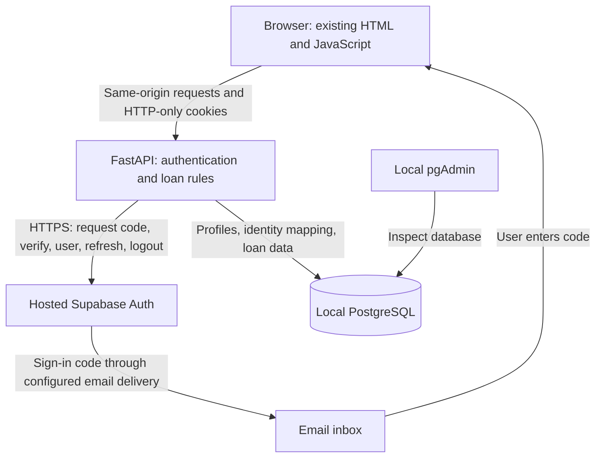
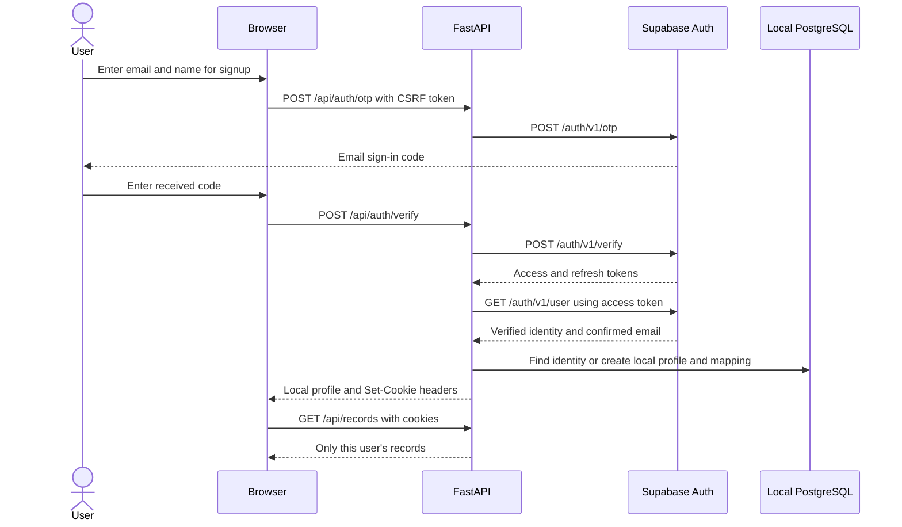
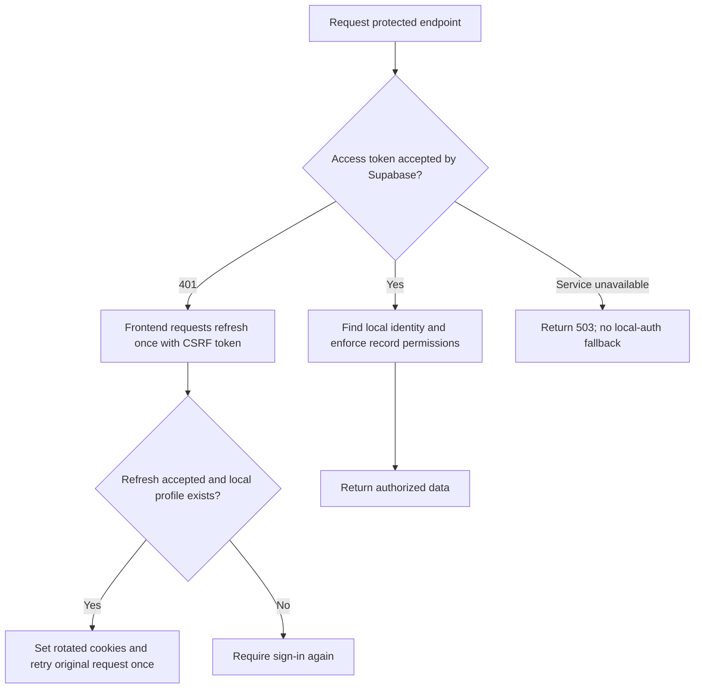
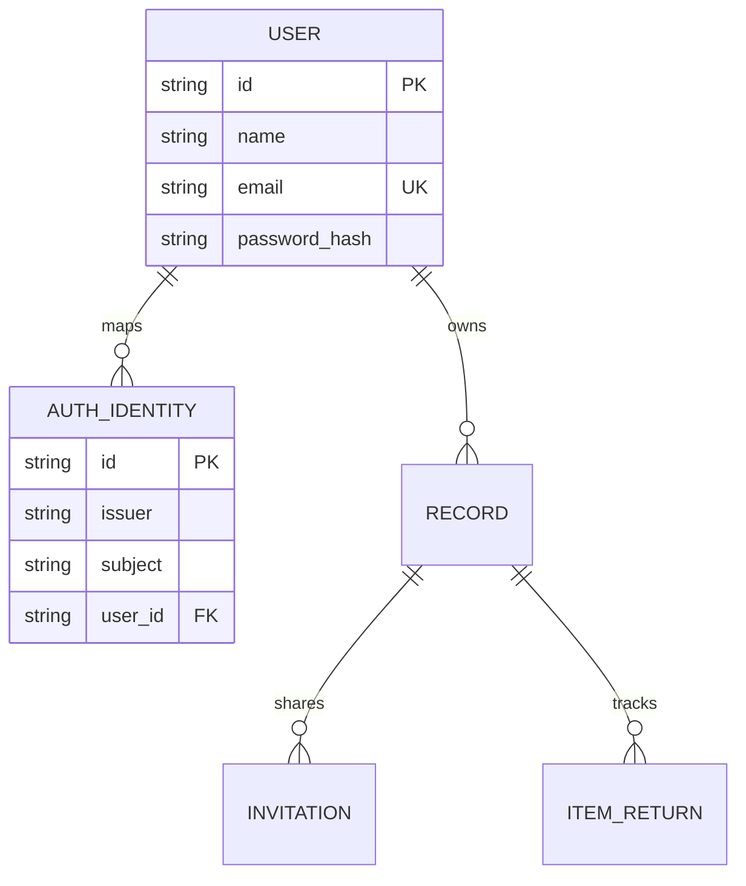

# Supabase authentication in Udhaar

## Purpose and scope

Udhaar uses hosted Supabase Auth to verify users through email one-time codes.
FastAPI manages the browser-facing login endpoints. Local PostgreSQL stores the
application profiles, contacts, loans, shared links, acknowledgments, and returns.
The same Docker Compose stack also runs pgAdmin for inspection.

Supabase necessarily stores authentication identities and session information in
its own project database. This integration does not use Supabase's application
tables, Storage, or Data API. Display names are stored locally, not sent as user
metadata. Only the email and authentication credentials needed for sign-in go to
Supabase. See [Supabase Auth](https://supabase.com/docs/guides/auth).

Loan-link guests do not need an account. They still acknowledge handover and
returns through the existing expiring bearer link. This document describes
account authentication; it does not replace loan-link permissions.

## Architecture



This is a server-side integration rather than a browser SDK integration. It fits
the current same-origin application and does not require React, a frontend build,
or loading a third-party authentication script. The publishable key and provider
tokens are not returned to frontend JavaScript.

Authentication answers which account is signed in. FastAPI authorization still
checks record ownership, the guest's loan token, and the lender's role when a
return is confirmed. A successful login does not grant access to other users'
records.

## Required Supabase project setup

**Custom SMTP is a prerequisite for this code-based flow on newly created Free
projects.** Since June 3, 2026, those projects cannot edit authentication templates
while using Supabase's default sender. Configure your own SMTP before changing
the templates below. Pro and older projects have different template permissions;
email-delivery restrictions still need to be considered. See
[Supabase's template-customization announcement](https://supabase.com/changelog/46599-changes-to-email-template-customisation-on-free-tier).

For local testing, a hosted SMTP sandbox such as Mailtrap Email Sandbox can
capture authentication emails in a web inbox, without delivering them to actual
recipients. Copy the sandbox SMTP credentials into Supabase's **Authentication >
Email > SMTP Settings** manually; the production Mailtrap integration is a
different product. Read codes from the sandbox inbox, then enter them in Udhaar.
Use a real transactional email provider and verified sender for public users.
See [Mailtrap sandbox setup](https://docs.mailtrap.io/email-sandbox/setup).

1. Use a development project, enable Email authentication, and allow signups.
2. Set the Site URL to `http://localhost:8000`, or your configured application port.
   This integration uses typed codes, so no OAuth callback route is required.
3. In **Authentication > Email > Templates**, update **both Confirm sign up**
   and **Magic Link / OTP** templates to include the code variable:

   ```html
   <h2>Your Udhaar sign-in code</h2>
   <p>{{ .Token }}</p>
   ```

   Configure a code length supported by the UI (6–10 digits). The default
   passwordless email flow sends a link; the templates make this a code experience.
   New or unconfirmed accounts use **Confirm sign up**; confirmed accounts use
   **Magic Link / OTP**. Save both so the first signup and subsequent sign-ins
   deliver codes. See [email templates](https://supabase.com/docs/guides/auth/auth-email-templates)
   and [email OTP configuration](https://supabase.com/docs/guides/auth/auth-email-passwordless).
4. Verify that custom SMTP is configured and enabled before testing delivery.
   Supabase's built-in sender is limited to team-member addresses and does not
   permit the template customization this flow needs on new Free projects.
   A successful local unit test cannot validate email delivery. See
   [SMTP restrictions and setup](https://supabase.com/docs/guides/auth/auth-smtp).
5. Put the project URL and publishable key in the ignored local `.env`:

   ```dotenv
   UDHAAR_AUTH_PROVIDER=supabase
   SUPABASE_URL=https://YOUR_PROJECT.supabase.co
   SUPABASE_PUBLISHABLE_KEY=YOUR_PUBLISHABLE_KEY
   ```

   Use the project base URL, without `/auth/v1` or a trailing path. HTTPS is
   required. No database password or service-role key from Supabase is needed.
   The local Postgres password remains a separate Compose setting.
6. Recreate the app to load the variables:

   ```powershell
   docker compose up --build -d --wait app
   ```

   `.env` is read by Compose, not automatically by a Python process launched
   directly on the host. For a direct Python launch, export the variables into
   that process environment.

Do not put keys in this document, frontend files, screenshots, or commits. See
[Supabase API keys](https://supabase.com/docs/guides/getting-started/api-keys).

## Signup and login flow



Signup requests send `create_user: true`; sign-in requests send
`create_user: false`. Code requests return a generic eligibility message. The
backend checks the confirmed email and rejects anonymous identities or an email
different from the one being verified. Names are display text, not proof of
identity. Email control is not verification of a real-world person.

No shared mutable Supabase SDK session is used. Each provider request has its own
HTTP client, explicit credentials, timeout, and fixed configured HTTPS destination.
This avoids one user's provider session leaking into another request.

## Protected requests, refresh, and logout

FastAPI calls Supabase's authenticated `/user` endpoint to validate an access
token, then looks up the provider identity in local PostgreSQL. It never trusts
an email or user ID supplied by the browser, nor merely decodes a JWT and assumes
it is valid. This network validation adds latency and means protected requests
need Supabase connectivity. See [server-validated user retrieval](https://supabase.com/docs/reference/python/auth-getuser).



The frontend shares an in-flight refresh promise within the page so simultaneous
requests do not each try to rotate the same refresh token. It does not refresh
anonymous loan-link requests. Session changes in multiple browser tabs still rely
on the provider's refresh reuse behavior; there is no cross-tab coordination yet.

| Cookie | Purpose | Browser access | Lifetime and scope |
|---|---|---|---|
| `udhaar_sb_access` | Supabase access token | HTTP-only | Provider `expires_in`, path `/` |
| `udhaar_sb_refresh` | Refresh provider session | HTTP-only | Browser persistence cap of 14 days, path `/api/auth` |
| `udhaar_csrf` | Double-submit CSRF check | Readable by JavaScript | Existing CSRF mechanism, path `/` |

Authentication cookies use `SameSite=Lax`. Compose uses plain HTTP locally and
therefore `Secure=false`; production must use HTTPS and secure cookies. Tokens
are stored in browser cookies, not local PostgreSQL or browser localStorage.
HTTP-only does not remove the need to prevent script injection and protect CSRF.

Sign-out requests provider revocation with `scope=local`, clears this browser's
auth cookies, and leaves local profiles and loans intact. If the access cookie
has expired, sign-out first attempts refresh to obtain a token for revocation.
During an outage it still clears browser cookies and returns
`provider_session_revoked: false`. Already-issued access tokens should not be
assumed instantly unusable after logout; provider token expiration and revocation
semantics still apply. See [Supabase sessions](https://supabase.com/docs/guides/auth/sessions).

## Local data model and compatibility



`auth_identities` has a unique `(issuer, subject)` pair. `issuer` is the configured
project URL plus `/auth/v1`; `subject` is the verified Supabase UUID. Including the
issuer prevents changing projects from silently reusing an unrelated identity.
Application foreign keys continue referencing the existing local `users.id`.

New OTP profiles have an empty, unusable `password_hash` to retain compatibility
with the current non-null database column. No password is collected. Legacy
`login_sessions` is unused in Supabase mode. Both local password endpoints and
legacy session-cookie authentication are disabled in that mode.

Existing local users and loans are preserved. We deliberately do not attach a
Supabase identity to a legacy profile just because email strings match. The first
verified sign-in with a colliding email returns 409 and requires an explicit
future migration. For initial testing, use an email not already used by a legacy
local profile. Repeated verified logins reuse the same mapped profile.

The new mapping table is created by the existing `create_all` startup mechanism;
existing tables are not rewritten. Concurrent profile-creation conflicts roll
back and resolve the existing mapping when possible. Formal versioned schema
migrations remain a separate production requirement.

## Endpoints and changed code

| Endpoint | Behavior |
|---|---|
| `GET /api/auth/config` | Provider, method, configuration readiness; no credentials |
| `POST /api/auth/otp` | Request signup/sign-in email code |
| `POST /api/auth/verify` | Verify code, validate identity, provision profile, set cookies |
| `POST /api/auth/refresh` | Rotate provider session and cookies |
| `POST /api/auth/logout` | Attempt revocation and clear browser cookies |
| `GET /api/me` | Return mapped local profile after provider validation |
| Existing `/api/records` endpoints | Same ownership rules, new authentication dependency |
| Existing `/api/share/...` endpoints | Same anonymous bearer-link access |

All POST authentication endpoints require the existing CSRF cookie/header pair.

| File | Change |
|---|---|
| `backend/supabase_auth.py` | Provider HTTP adapter, email validation, OTP endpoints, identity mapping, cookies, refresh/logout, bounded rate limiting |
| `backend/main.py` | Register auth routes, select authentication mode, block legacy password endpoints in Supabase mode |
| `backend/models.py` | Add `AuthIdentity` without changing application ownership IDs |
| `static/app.js` | Email/code forms, resend, setup message, one automatic refresh/retry, correct sign-out route |
| `requirements.txt` | Promote HTTPX to a runtime dependency |
| `compose.yaml` | Pass auth settings to app; explicitly keep legacy regression tests in local mode |
| `.env.example` | Document required environment variables |
| `tests/conftest.py` | Share isolated database fixtures across both test modules |
| `tests/test_supabase_auth.py` | Simulate provider HTTP for authentication/security regressions |
| `scripts/smoke_test.py` | Prevent the older password smoke test running against OTP mode |

There is a basic in-process, per-IP and per-email limit: five code requests or ten
verification attempts per minute. It is bounded in memory and resets on restart.
It is sufficient for local testing, not distributed production abuse protection.
Provider limits also apply; the server-side integration sends provider requests
from the backend's network address. Configure production limits and trusted proxy
handling before public use.

## Testing and acceptance

Implementation validation: **27 automated tests passed against local PostgreSQL
in Docker**. JavaScript syntax checking also passed. The running Docker app has
also successfully authenticated a read-only settings request against the real
Supabase project: email authentication is enabled, signups are allowed, and email
auto-confirm is disabled. Real email delivery and code verification still require
the manual test below; a successful settings request does not establish delivery.

Run automated tests against PostgreSQL:

```powershell
docker compose --profile test run --build --rm tests
```

The suite covers both auth modes. Supabase responses are simulated with HTTPX
MockTransport; no real email, service-role key, or Supabase admin user is needed.
Each test uses an isolated database schema and removes it afterward.

Authentication scenarios include local profile creation, no stored password or
tokens, stable identity mapping, account isolation, secure cookie attributes,
refresh rotation, invalid codes, CSRF, legacy-cookie/password bypass rejection,
email collisions, provider outage, logout during outage, unverified identities,
rate limiting, missing configuration, and anonymous loan completion.

After configuring the real project, complete this manual check:

1. Open `http://localhost:8000/signup`, enter a name and eligible test email.
2. Confirm the real email arrives, enter the code, and reach the dashboard.
3. In pgAdmin inspect `public.users` and `public.auth_identities`: the mapping
   exists, the name is local, and no provider tokens are stored.
4. Create a loan. Refresh the browser; the same profile and loan should load.
5. Sign out, confirm account endpoints reject access, and sign back in. The local
   profile ID should remain unchanged.
6. Open a loan link in a private browser window; acknowledge and complete a
   return without signing in.
7. Test a second account and confirm it cannot read the first account's records.
8. Remove only the access cookie in browser developer tools, keep the refresh
   cookie, and reload. The browser should refresh and restore access.
9. Confirm the stored Supabase user has an email identity; no Udhaar loan tables
   or profile metadata were uploaded.

Automated tests demonstrate code behavior against a simulated provider. Only the
manual real-project check demonstrates project configuration and email delivery.

### Troubleshooting a 503 while requesting a code

If `/api/auth/otp` returns 503 but Supabase's read-only `/settings` request works,
the project URL and API key can be valid while email delivery is failing. Check
**Supabase > Authentication > Logs** for the precise SMTP or email-template error.
Verify that the SMTP host is just a hostname (no `https://` or embedded port),
the port is correct, and username/password come from the same SMTP product.
Mailtrap Email Sandbox credentials differ from its Email Sending credentials.
For Sandbox, messages appear in the Mailtrap web inbox, not the recipient's Gmail.

If the Auth log says `tls: first record does not look like a TLS handshake`,
the SMTP connection is using a TLS mode inconsistent with the server response.
For Mailtrap Sandbox, use `sandbox.smtp.mailtrap.io` with port `587` and the
sandbox credentials. Mailtrap Sandbox supports STARTTLS; using port `465` can
cause a client to attempt implicit TLS before the SMTP greeting. Save the SMTP
settings in Supabase and request a fresh code. No Docker restart is needed.
For another provider, use that provider's documented port/encryption combination.

The app logs the provider endpoint, upstream status, and a sanitized error code.
It does not log email addresses, token values, request bodies, or raw SMTP error
messages. Run `docker compose logs --tail 50 app` after one failed attempt. The
email-send timeout is 30 seconds, with a 5-second connection timeout; ordinary
authentication requests keep a 10-second timeout. No code request is automatically
retried, to avoid duplicate emails and triggering provider limits.

## Development mode and production follow-up

For the earlier password workflow, set `UDHAAR_AUTH_PROVIDER=local` and recreate
the app container. This is an explicit development switch, not a fallback when
Supabase is unavailable. Direct host Python defaults to local mode unless the
environment says otherwise. Never use that switch as an outage workaround for a
public deployment.

Before production: enable HTTPS and secure cookies, add formal migrations,
distributed rate limits and monitoring, decide account migration/deletion policy,
configure reliable SMTP, and test session behavior across browsers and failures.
Supabase manages authentication infrastructure; Udhaar still manages application
permissions, privacy choices, local backups, and retention. See
[shared responsibilities](https://supabase.com/docs/guides/deployment/shared-responsibility-model).
