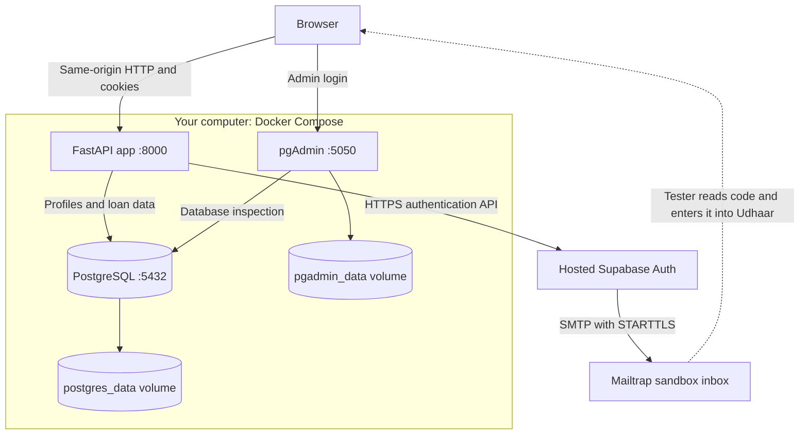
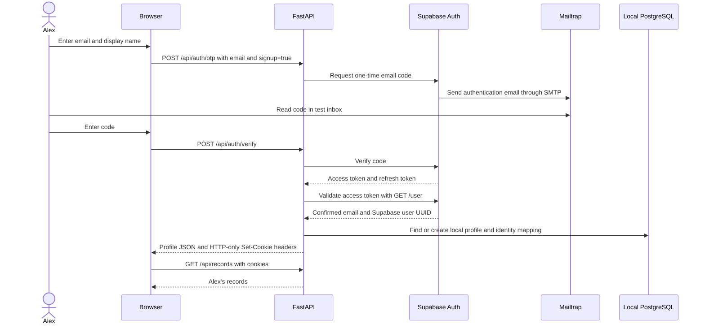
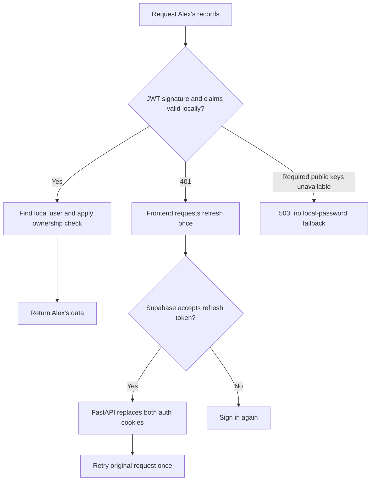
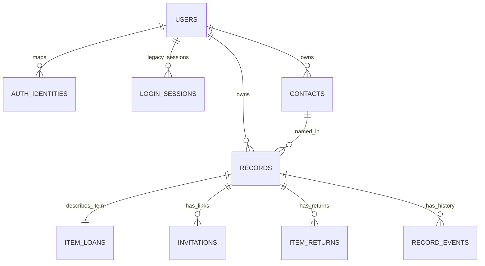
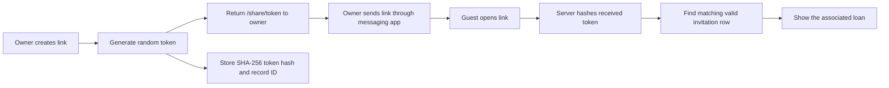
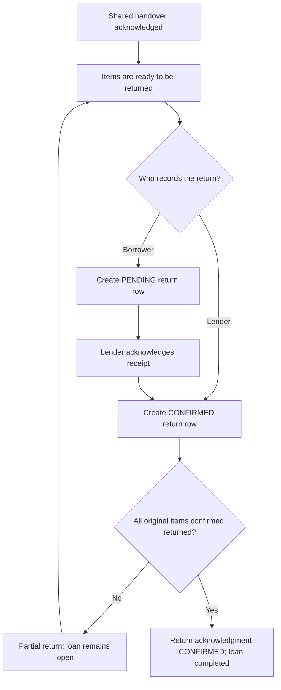

# Understanding Udhaar: authentication, data, sharing, and email

This guide explains the current implementation, updated on October 19, 2026.
The user has reported that the live flow works. For installation steps and a
file-by-file implementation reference, use [the Supabase implementation document](supabase-implementation.md).

## Reading map

1. [The components and their jobs](#the-components-and-their-jobs)
2. [What happens when you sign in](#what-happens-when-you-sign-in)
3. [Tokens and their storage](#tokens-and-their-storage)
4. [Refresh, logout, and permissions](#refresh-logout-and-permissions)
5. [Why the database has these tables](#why-the-database-has-these-tables)
6. [Loan links and the two acknowledgments](#loan-links-and-the-two-acknowledgments)
7. [Docker, PostgreSQL, and pgAdmin](#docker-postgresql-and-pgadmin)
8. [Mailtrap and the email failure](#mailtrap-and-the-email-failure)
9. [Inspecting the system yourself](#inspecting-the-system-yourself)
10. [Boundaries of the current prototype](#boundaries-of-the-current-prototype)

## The components and their jobs

Udhaar combines a local application with an external identity service. Keeping
these responsibilities separate lets us change the application without building
an entire identity platform.

| Component | Its job in this implementation | Where it runs |
|---|---|---|
| HTML, CSS, JavaScript | Screens, forms, API calls, display of results | Browser, with files served by FastAPI |
| FastAPI | Coordinate authentication and enforce loan permissions and rules | Docker `app` service |
| Supabase Auth | Verify email codes, issue tokens, manage authentication sessions | Hosted Supabase project |
| PostgreSQL | Store Udhaar profiles and application records | Docker `db` service |
| pgAdmin | Inspect and administer local PostgreSQL | Docker `pgadmin` service |
| Mailtrap Email Sandbox | Receive and display test authentication emails | Hosted sandbox |



The browser's application requests go through FastAPI. It does not directly query
Supabase tables or local PostgreSQL. The current setup uses Supabase **Auth**,
not Supabase's application database APIs, file storage, or realtime service.
Supabase still maintains its own authentication users and sessions internally.
See [Supabase Auth architecture](https://supabase.com/docs/guides/auth).

The distinction between authentication and authorization explains much of the
design. Authentication identifies an account. Authorization determines which
records and actions that account may access. Supabase supplies the identity;
FastAPI applies Udhaar's ownership and lender/borrower rules.

## What happens when you sign in

Use Alex as a running example. Alex creates an account and later lends three
books to Rahul.

First, the frontend gets a CSRF token from `/api/csrf` and checks
`/api/auth/config`. In Supabase mode it displays the email-code form. Choosing
signup permits a new Supabase identity; choosing sign-in requests access to an
existing one. The name entered on signup stays in the application flow and is
saved locally after successful verification.



The app only creates the local profile after validating the identity. Receiving
an email alone does not complete login. A successful login returns profile data
such as the local ID, name, and email in JSON; provider tokens travel in cookie
headers instead of JSON readable by frontend code.

Supabase sees the email, authentication requests, and service metadata. Mailtrap
sees the recipient and authentication email contents, including the code. The
application does not send loan details, contacts, private notes, or display names
to these services as part of this flow.

## Tokens and their storage

A token is a value that lets a request demonstrate a particular permission or
continue an authenticated session. The word does not imply a single format or
purpose. Udhaar uses several different kinds.

| Value | Purpose | Where it is kept | Lifetime or scope |
|---|---|---|---|
| Email OTP | Prove access to the email/code channel during login | Generated/verified by Supabase; included in Mailtrap email; briefly entered in the browser | Single-use verification, provider-configured expiration |
| Supabase access token | Authenticate the account on protected requests | Browser HTTP-only cookie `udhaar_sb_access` | `max_age` uses provider `expires_in`; path `/` |
| Supabase refresh token | Obtain a new access/refresh pair | Browser HTTP-only cookie `udhaar_sb_refresh` | Browser persistence cap of 14 days, reset when refreshed; path `/api/auth` |
| CSRF token | Protect state-changing browser requests | Readable `udhaar_csrf` cookie and frontend memory | Checked against `X-CSRF-Token`; not an account identity |
| Loan-link token | Access and act on one shared loan | Raw token in `/share/<token>` URL; SHA-256 hash in `invitations` | 30 days from link creation, unless declined/revoked earlier |
| Publishable project key | Identify the Supabase project/application request | Local `.env`, then app-container environment | Project-level configuration, not a user's login |

Our local database does **not** store Supabase access tokens, refresh tokens, or
OTP codes. Supabase maintains provider-side session state; the browser holds the
credentials it needs to continue that session.

The access token is a signed JWT: a structured credential with claims such as
user identity and expiration. Signing protects against undetected modification;
it does not encrypt the payload. Decoding a token is different from validating
it. Ordinary protected requests verify the signature and claims locally with
Supabase's cached public signing keys. Session creation and refresh also validate
the user through Supabase's `/user` endpoint. See [JWT concepts](https://supabase.com/docs/guides/auth/jwts).

### What HTTP-only cookies mean

FastAPI sends `Set-Cookie`; the browser stores the values and automatically sends
them on matching requests. `credentials: 'same-origin'` is set on frontend API
calls. JavaScript never needs to read the auth tokens.

`HttpOnly` prevents ordinary page JavaScript from reading the cookie through
`document.cookie`. It does not itself encrypt the token or make a compromised
browser safe. `SameSite=Lax` limits some cross-site cookie use. Our local HTTP
setup uses `Secure=false`; HTTPS production deployment must use secure cookies.

Cookie paths reduce where each token is sent. The refresh token is only attached
to matching `/api/auth` requests, whereas the access cookie uses `/`. Cookies
follow host/path rules rather than port isolation, so different localhost ports
are not separate security domains. Do not treat the local multi-service setup as
a production isolation design.

The 14-day refresh-cookie value is a browser storage policy, not a guarantee that
Supabase's session remains valid for exactly 14 days. The provider can reject it
earlier, and successful refreshes write a new cookie with a new 14-day cap.

## Refresh, logout, and permissions

### Refreshing a session

An expired access token should not force Alex to type a code for every visit.
The frontend reacts to a 401 on `/api/me` or `/api/records...` by requesting one
refresh. FastAPI sends the HTTP-only refresh token to Supabase, validates the new
identity, and replaces both cookies. The original request is then retried once.



Supabase rotates session tokens during refresh. One page shares an in-flight
refresh promise, reducing duplicate refreshes from concurrent requests. There is
no custom cross-tab coordination. See [Supabase sessions](https://supabase.com/docs/guides/auth/sessions).

### Authorization after authentication

For a protected record lookup, the backend checks `record.owner_id == user.id`.
Knowing a record ID alone does not grant access. The current API returns 404 for
another user's record. Guest link routes have a separate permission check based
on the link token and its associated record.

Ordinary owner requests now use local JWT verification and local PostgreSQL.
Internet access is still required for new sign-ins, refresh, and public-key fetches
when keys are not cached. Provider-side account deletion or banning is not checked
on every application request; existing tokens may remain valid until expiry.
Loan-link routes use local PostgreSQL and do not call Supabase for guest auth.

### Signing out

FastAPI attempts to revoke the current provider session with `scope=local`, then
clears the browser's cookies. If the access cookie is absent but a refresh cookie
remains, it first attempts refresh so it can request revocation. During provider
failure it still clears cookies and reports that remote revocation was not
confirmed.

Sign-out does not delete the local user or loan records. Already-issued access
tokens should not be assumed instantly invalid after provider sign-out; the
current code does not implement its own per-token denylist. Expiration and
provider revocation semantics still matter.

### Why CSRF exists alongside login tokens

Browsers automatically attach cookies. CSRF protection helps prevent another
website from inducing an unwanted state-changing request using those cookies.
For POST/PATCH operations, the app checks the `udhaar_csrf` cookie against the
`X-CSRF-Token` header. Frontend JavaScript can read/use that token; it cannot read
the HTTP-only auth tokens. A CSRF token does not prove which user is signed in.

## Why the database has these tables

Each table represents a different entity or repeatable activity. Separating them
avoids putting every return, event, and link into one growing loan row.

| Table | What one row represents | Why it exists |
|---|---|---|
| `users` | Local Udhaar profile | A stable application owner ID, name, and email for records |
| `auth_identities` | Supabase identity mapped to a local user | Connect external identity to existing application ownership IDs |
| `login_sessions` | Earlier local-password login session | Compatibility with explicit local development mode; unused by Supabase login |
| `contacts` | A person recorded by one account owner | Track counterparties who do not need registered accounts |
| `records` | A loan's common details and handover status | Owner, contact, direction, privacy mode, dates, private notes |
| `item_loans` | Item details attached to one record | Name, category, and original quantity, separate from common loan details |
| `invitations` | A particular loan-sharing link | Hash, record association, expiry, response time, state and revocation |
| `item_returns` | A quantity returned or proposed for return | Multiple partial returns and lender acknowledgment per return |
| `record_events` | An activity-history entry | Timestamped creation, link generation, acknowledgment, and return history |

The table called `invitations` is a historical internal name. It now backs loan
links. **Invite friends** only copies `/signup`; it does not create an invitation
row or track referrals.



### Why both users and auth identities exist

These IDs serve different systems:

```text
Supabase subject sb-user-A
        + issuer https://PROJECT.supabase.co/auth/v1
                     |
             auth_identities
                     |
          Local users.id local-user-17
                     |
          records.owner_id local-user-17
```

The real IDs are UUID strings. The `(issuer, subject)` pair is unique. Including
the issuer distinguishes different Supabase projects. Existing account ownership
does not depend on an email string remaining unchanged.

On repeated sign-in, the mapping reuses the same local profile. A verified email
matching an old local-password profile does not automatically claim that profile;
the app returns 409 and requires deliberate migration. Local profile emails are
not currently synchronized when an existing Supabase identity changes its email.

The `password_hash` column remains because the earlier schema requires it. New
OTP profiles store an empty, unusable value. Legacy users can retain their old
Argon2 hashes, but Supabase mode disables the legacy password login endpoints and
ignores legacy `udhaar_session` cookies.

### Contacts, items, and history

Alex's contact Rahul is local to Alex's account; it is not automatically connected
to a registered Rahul account. Two owners may each have a contact named Rahul.
Name matching is not identity verification.

Separating `item_loans` from `records` leaves room for other record types in the
future. Today this application tracks physical items, not money or payments.

`record_events` is useful activity history, but not a tamper-proof audit ledger.
Actors are stored as `OWNER` or `GUEST`; guest actions have no verified user ID.
The application does not record proof that a named person clicked a link, nor
does generating a link establish that a message was sent, delivered, or read.

## Loan links and the two acknowledgments

### Creating and resolving a link

Alex generates a loan link while signed in. FastAPI verifies Alex owns the record,
creates a random token, and stores its SHA-256 hash with the record ID and expiry.
The raw token is returned once for the browser to display and copy.



The guest does not need an access or refresh token. Possession of the loan URL is
the permission to view and act on that loan. This is a **bearer link**: whoever
holds it can use it. It does not identify the holder as Rahul. The owner accepts
responsibility for sharing it with the intended person.

Private notes and the owner's event history are removed from the guest response.
The guest can see the relevant item details, owner/contact names, quantities,
dates, acknowledgment state, and return data.

### Acknowledgment 1: the initial handover

Direction is always relative to the owner who created the record:

| Record direction | Owner's role | Link holder's role | Handover action on the link |
|---|---|---|---|
| `LENT` | Lender | Borrower | I took / borrowed this item |
| `BORROWED` | Borrower | Lender | I gave / lent this item |

Accepting a link changes `invitations.state` from `PENDING` to `ACCEPTED`, sets
`records.acknowledgment` to `CONFIRMED`, records `responded_at`, and adds an event.
Declining records `DECLINED`; that link then becomes unavailable. Viewing a link
alone does not acknowledge anything. A duplicate response is rejected.

### Acknowledgment 2: return and completion

Borrowers can report a return. Only the lender's role can confirm receipt. A
lender recording receipt directly creates a confirmed return without a separate
borrower proposal. The owner's role is known through their account; the guest's
role is assigned by the loan link and direction.



For Alex's three books, suppose Rahul reports two books returned:

| Moment | Confirmed quantity | Pending quantity | Outstanding quantity | Loan settlement |
|---|---:|---:|---:|---|
| After handover | 0 | 0 | 3 | `OUTSTANDING` |
| Rahul reports two returned | 0 | 2 | 3 | `OUTSTANDING` |
| Alex confirms receipt | 2 | 0 | 1 | `PARTIAL` |
| Final book confirmed received | 3 | 0 | 0 | `RETURNED` |

The quantity formula is:

```text
outstanding = original quantity - sum(CONFIRMED returns)
available for a new return = original quantity - sum(CONFIRMED and PENDING returns)
```

Pending returns reserve quantities to prevent duplicate proposals from counting
the same items twice. They do not yet reduce outstanding quantity.

### Stored states versus calculated states

The handover acknowledgment is saved in `records.acknowledgment` and returned by
the API under both `acknowledgment` and `handover_acknowledgment` for compatibility.
The API derives `return_acknowledgment` from the return rows:

| Value | Meaning |
|---|---|
| `NONE` | No confirmed or pending returns yet |
| `PENDING` | At least one return awaits lender acknowledgment |
| `PARTIAL` | Some items confirmed returned, more outstanding, none currently pending |
| `CONFIRMED` | Every item confirmed returned |
| `NOT_REQUIRED` | Private `OFF` record; no shared acknowledgment needed |

Settlement is separately calculated as `OUTSTANDING`, `PARTIAL`, or `RETURNED`.
Handover confirmation does not change settlement. Return completion does not erase
the original handover acknowledgment. If some items are confirmed and others are
pending, settlement can be `PARTIAL` while return acknowledgment is `PENDING`.

Private `OFF` records are simpler: the owner directly records returns, which are
immediately confirmed. No guest or shared handover is required.

### Expiry and replacement

Loan links expire 30 days after creation, including accepted links. Expiry denies
further link access; it does not erase the loan or its acknowledgment history.
Replacing an active link revokes earlier links and sets handover back to pending.
The current implementation refuses new/replacement links once any quantity has
been confirmed returned. Renewal for a partially returned loan is therefore a
future improvement if a link expires before completion.

Because the database stores only the hash, it cannot recover the original raw
URL. Keep the copied link if you plan to reuse it. Logging out of an account does
not revoke loan links; their lifetime is independent of authentication sessions.

## Docker, PostgreSQL, and pgAdmin

Docker packages the app and database as separate processes with their own
dependencies. Compose connects them on a private Docker network, supplies
environment variables, and orders startup using health checks.

Inside the app container, PostgreSQL is `db:5432`. Inside pgAdmin, it is also
`db:5432`. A desktop database client uses `localhost` and the published database
port instead. `localhost` inside a container refers to that container itself.

The app, database, and pgAdmin ports are bound to `127.0.0.1` in Compose, making
this setup accessible from the same computer. Changing the browser address alone
does not publish the containers to other Wi-Fi devices.

| Location | What to inspect |
|---|---|
| `http://localhost:8000` | Udhaar application |
| `http://localhost:8000/api/docs` | API endpoint reference |
| `http://localhost:5050` | pgAdmin |
| Supabase dashboard | Auth users, configuration, authentication logs |
| Mailtrap sandbox | Captured authentication emails and codes |

pgAdmin is an administration application, not the database itself. Its login is
separate from both Udhaar and PostgreSQL. It keeps its own settings database in
the `pgadmin_data` volume; those internal settings are not Udhaar's `users` table.

PostgreSQL files live in `postgres_data`. Data survives app rebuilds and normal
`docker compose down`/`up`. The `-v` option on `down` deletes named volumes, so it
can delete the database. A persistent volume is not a backup: it does not protect
against accidental data edits or volume loss.

Compose reads `.env` and passes selected values to each service. Updating an app
environment variable requires container recreation. Updating Supabase SMTP or
email templates is remote configuration and does not require a Docker restart.
This project uses `create_all` to create missing tables; existing table changes
still need a migration strategy before production.

## Mailtrap and the email failure

Supabase creates/verifies the code. SMTP transports the email. Mailtrap Sandbox
captures it. Mailtrap does not decide which account is authorized or which loan
belongs to a user.

The sandbox is for developer testing: the recipient can be an email address, but
the message is captured in the sandbox inbox instead of delivered to that person's
ordinary mailbox. A tester reads it there and types it into Udhaar. Access to the
sandbox therefore gives access to test codes. See
[Mailtrap's sandbox integration](https://docs.mailtrap.io/email-sandbox/setup/sandbox-smtp-integration).

We configured code templates for both **Confirm sign up** and **Magic Link / OTP**.
They use `{{ .Token }}` instead of a confirmation link. Newly created Supabase
Free projects require custom SMTP to customize these templates; the restriction
was introduced on June 3, 2026. See
[Supabase's announcement](https://supabase.com/changelog/46599-changes-to-email-template-customisation-on-free-tier).

The observed `tls: first record does not look like a TLS handshake` error meant
the SMTP connection tried a TLS mode inconsistent with the response it received.
For Mailtrap Sandbox our documented configuration is `sandbox.smtp.mailtrap.io`
on port `587`, which supports upgrading the SMTP connection using STARTTLS.

These are two separate network connections:

```text
FastAPI --- HTTPS ---> Supabase Auth --- SMTP / STARTTLS ---> Mailtrap
```

A working HTTPS API key check can coexist with a failed SMTP connection. That is
why `/settings` succeeded while `/otp` failed. Supabase returned 500; FastAPI
translated the dependency failure to 503. The gateway/edge log showed status only;
the Auth service log exposed the actual TLS error.

For public users, replace the sandbox with a transactional sending service and
configure its verified sender/domain. Supabase remains the authentication service;
only the email-delivery destination changes.

## Inspecting the system yourself

Use pgAdmin's Query Tool on the local `udhaar` database. These queries read data
without changing it. Use your own test records; no token values are needed.

See how profiles map to Supabase identities:

```sql
SELECT u.id, u.name, u.email, a.issuer, a.subject
FROM users AS u
LEFT JOIN auth_identities AS a ON a.user_id = u.id
ORDER BY u.created_at DESC;
```

See loans and their initial handover states:

```sql
SELECT r.id, r.owner_id, c.name AS contact, i.item_name,
       i.quantity, r.direction, r.mode, r.acknowledgment
FROM records AS r
JOIN contacts AS c ON c.id = r.contact_id
JOIN item_loans AS i ON i.record_id = r.id
ORDER BY r.created_at DESC;
```

See individual return acknowledgments:

```sql
SELECT record_id, quantity, status, proposed_by, confirmed_by,
       created_at, confirmed_at
FROM item_returns
ORDER BY created_at DESC;
```

See loan-link state and expiry without showing tokens:

```sql
SELECT record_id, state, created_at, expires_at, responded_at
FROM invitations
ORDER BY created_at DESC;
```

See the activity history:

```sql
SELECT record_id, actor, event_type, description, created_at
FROM record_events
ORDER BY created_at DESC;
```

In browser developer tools, inspect Application/Storage > Cookies to see cookie
names, expiry, path, and HTTP-only flags. Do not share their values. The Network
tab shows the sequence of `/otp`, `/verify`, `/me`, record requests, and refresh.

For process health and diagnostics:

```powershell
docker compose ps
docker compose logs --tail 50 app
```

The health endpoint checks PostgreSQL connectivity; it does not prove email
delivery or Supabase availability. The auth-config endpoint indicates local
configuration readiness; it does not perform a live provider sign-in test.

## Boundaries of the current prototype

- Supabase manages authentication infrastructure; application access rules, local
  data, backups, and retention decisions remain our responsibility. See
  [shared responsibilities](https://supabase.com/docs/guides/deployment/shared-responsibility-model).
- Guest actions identify link possession and a role, not a verified person. This
  is the deliberately chosen simple sharing model.
- Owner dashboards do not receive automatic live updates when guests respond.
  Refresh to fetch new status.
- Return totals are checked in application code. Production work still includes
  transaction locking for simultaneous return requests and formal migrations.
- Email rate limiting is process-local: one send attempt per email per 60 seconds,
  five per IP per minute, and ten verification attempts per IP/email per minute.
  See [rate limits and signup behavior](auth-rate-limits.md) for all layers.
- No automatic migration of old local accounts, realtime synchronization, payment
  processing, or behavioral analytics was added by the auth integration.

## Code-reading route

Read these files in this order to connect the diagrams to implementation:

1. `compose.yaml`: which services run and how they connect.
2. `backend/models.py`: the nine tables and their relationships.
3. `backend/supabase_auth.py`: code request/verification, identity mapping,
   cookie storage, refresh, logout, and sanitized provider errors.
4. `backend/main.py`: owner authorization, link validation, acknowledgment,
   return rules, totals, and history.
5. `static/app.js`: frontend forms, cookie-based API requests, one refresh/retry,
   and guest actions.
6. `tests/test_supabase_auth.py` and `tests/test_mvp.py`: executable examples of
   authentication, isolation, acknowledgment, and return behavior.
