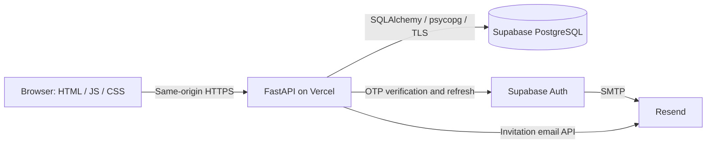
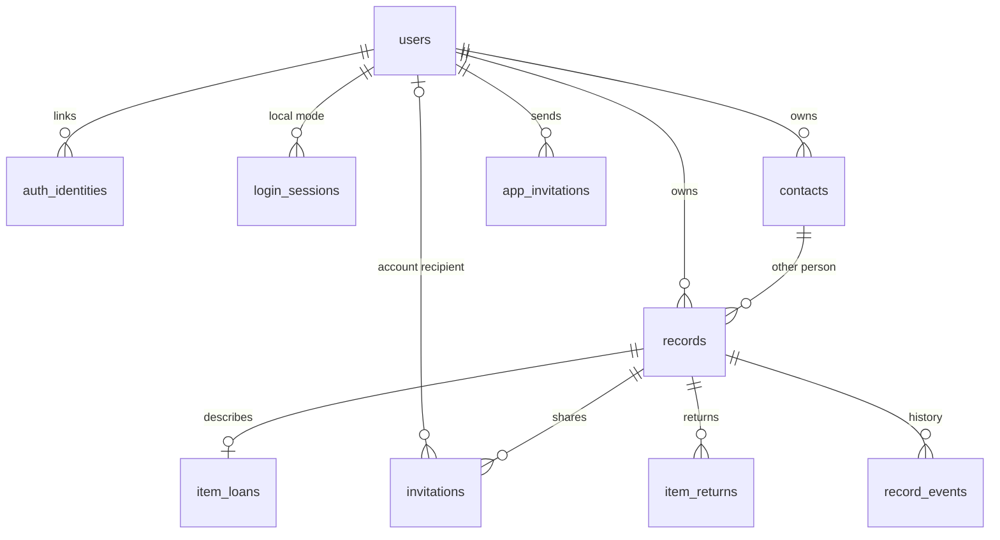

# Architecture and database schema

## Components

The frontend has no build step. FastAPI serves the UI, APIs, and policy pages.
Supabase manages authentication and the hosted database; application permissions
are checked by FastAPI. Browser JavaScript does not query the database or hold a
database/service-role secret. Vercel runs the app independently of local Docker.

`compose.supabase.yaml` runs the same backend locally against the hosted database.
With the current configuration it shares data and Auth with Vercel. `compose.yaml`
starts a separate Docker PostgreSQL database and pgAdmin. A direct Python run
defaults to SQLite and local password authentication.

## Tables

Hosted application tables are in `udhaar`; Supabase's managed Auth tables are in
`auth`. There are ten app tables plus Alembic's `alembic_version` table.

| Table | Purpose |
| --- | --- |
| `users` | App profile, unique email, name, ownership anchor. Hosted OTP accounts have no usable local password. |
| `auth_identities` | Maps provider issuer + subject to an app user; does not store provider tokens. |
| `login_sessions` | Hashed sessions for local password mode; unused in the Supabase sign-in flow. |
| `contacts` | An owner's people/contact names and optional emails. A contact need not have an account. |
| `records` | Shared loan fields: owner, contact, direction, mode, dates, notes, acknowledgment. |
| `item_loans` | Item name, category, and positive quantity; one extension row per item record. |
| `invitations` | Loan request, hashed token, recipient snapshot/account, delivery channel, response, expiry. |
| `app_invitations` | Regular invitation delivery history and two durable daily slots per sender. |
| `item_returns` | Positive quantities, proposed/confirmed actors, timestamps, and return status. |
| `record_events` | Activity timeline for creation, sharing, acknowledgments, and returns. |

Names are not unique. Only `users.email` is unique across app profiles. Contact
names/emails have no uniqueness constraint. Creation looks for the owner's
existing contact by email when supplied; without email, it matches name among
contacts without email. The email on a loan invitation is a recipient snapshot,
so sharing to a new address does not reassign other loans to a different person.

`auth_identities.subject` contains the Supabase user ID but has no database foreign
key to `auth.users`. Hosted sessions live in `auth.sessions`, while the browser
receives HTTP-only access/refresh cookies. See the [Auth guide](supabase-implementation.md).

## Loan lifecycle

1. An owner saves a private loan, or enters recipient email for On the Record.
2. An existing profile receives an inbox request; otherwise Resend emails a guest
   link. Sending is not acknowledgment, and the regular app-invite quota is separate.
3. The recipient accepts or declines the handover. Guest acceptance verifies
   possession of the link, not an independently established identity.
4. For a shared return, the borrower can propose returned quantity. Only the
   lender can confirm receipt. An owner's private return is immediately confirmed.
5. Confirmed quantities determine outstanding quantity and settlement. Pending
   quantities reserve capacity to avoid recording the same available items twice.

`direction=LENT` makes the owner the lender; `BORROWED` makes the other person the
lender. `acknowledgment` / `handover_acknowledgment` is `NONE`, `PENDING`,
`CONFIRMED`, or `DECLINED`. Settlement is independently `OUTSTANDING`, `PARTIAL`,
or `RETURNED`. Return acknowledgment is derived from return rows rather than
stored as a second loan status column.

Shared terms become locked after a request is sent. Replacing a request revokes
the old request and resets handover acknowledgment. New sharing is blocked after
confirmed returns exist. Requests expire after 30 days; expiry blocks access but
does not delete history. Registering after receiving a guest email does not
automatically attach the old request to the new account.

## Access boundaries

- Owner APIs filter by the authenticated app user.
- Inbox APIs require the invitation's recipient user ID.
- Guest APIs require a live, opaque bearer token whose SHA-256 hash matches.
- Recipient responses omit owner notes, contact email, and the internal timeline.
- Mutating APIs require a same-origin CSRF cookie/header match.
- The private hosted schema revokes browser-role access and enables RLS. The
  backend's table-owner connection bypasses RLS, so API checks remain essential.

These rules provide application access controls, not end-to-end encryption or
operator-blind storage. See the [Privacy notice](../PRIVACY.md) and
[database guide](supabase-database.md).

## Source map

| Path | Responsibility |
| --- | --- |
| `backend/main.py` | APIs, authorization, loan/invitation/return rules |
| `backend/supabase_auth.py` | Supabase OTP, JWT validation, refresh, local profile mapping |
| `backend/email_delivery.py` | Email validation, public URL, Resend transport |
| `backend/models.py`, `backend/database.py` | Tables, database settings, pooling |
| `backend/migrate.py`, `migrations/` | Explicit upgrades and read-only revision checks |
| `backend/policies.py` | Public pages rendered from repository policy documents |
| `static/` | Browser views, styles, and global policy links |
| `app.py`, `vercel.json` | Native Vercel entrypoint and build settings |

Use `/api/docs` and `/api/openapi.json` for the complete request/response contract.
